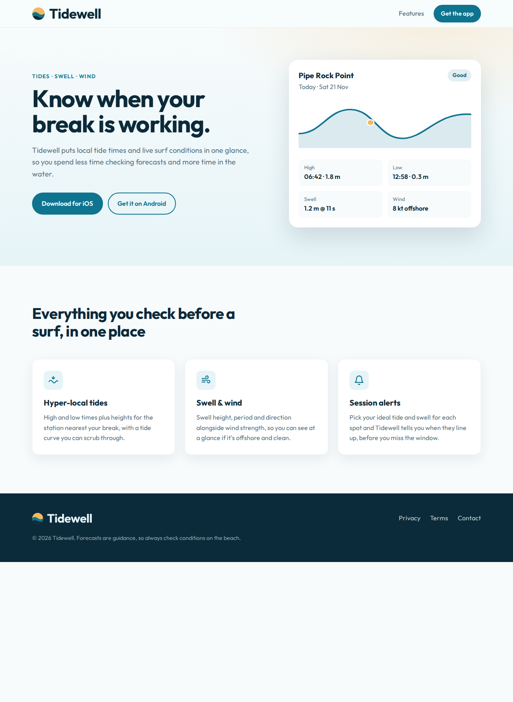
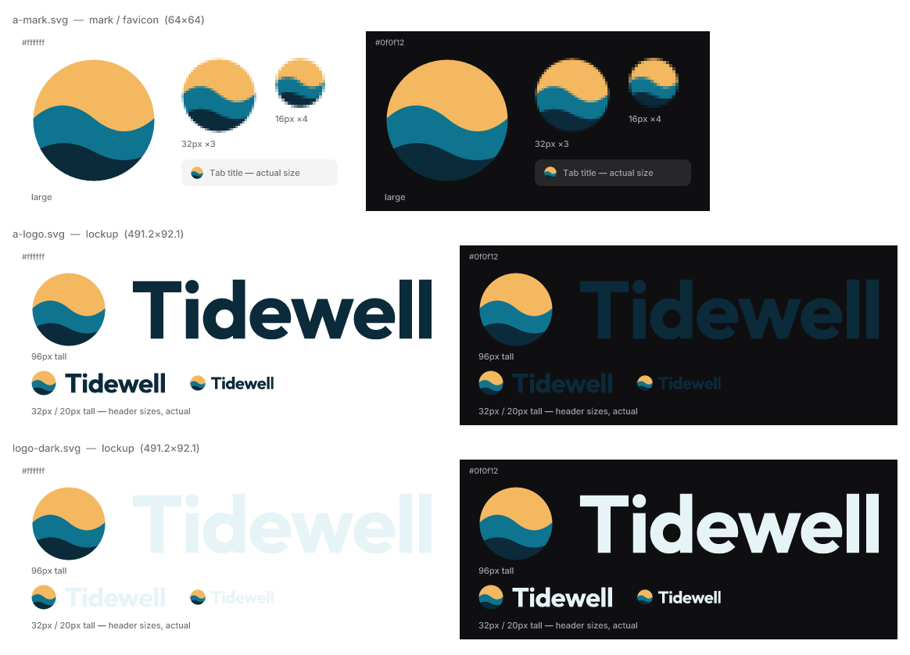
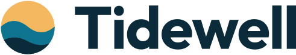
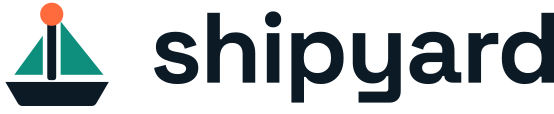

<p align="center">
  <picture><source media="(prefers-color-scheme: dark)" srcset="assets/logo-dark.svg"></picture>
</p>

<p align="center">
  <a href="https://github.com/benrwarner/clogo/actions/workflows/test.yml"></a>
  
  
</p>

<h3 align="center">Your coding agent designs a real logo. Not a letter in a square.</h3>

<p align="center">
  A Claude Code plugin that gives AI coding agents the tools and taste to ship relevant, crafted
  logos, favicons and app icons by default.
</p>

---

Ask any AI coding agent to build a website and you get the same logo every time: a rounded
square, a default indigo, and the first letter of the product name in a system font. It tells the
reader nothing about the product, and it makes every new project look unfinished.

**Clogo fixes that without you asking.** When an agent scaffolds a site or app, Clogo kicks in,
works out what the product is, and designs a logo that actually fits it. Then it wires every icon
file into the project.

## Before and after

One prompt, no mention of a logo:

> Scaffold a simple single-page landing site for 'Tidewell', an app that shows local tide times
> and surf conditions for surfers.

**Without Clogo:** a teal square with a white "T".

**With Clogo:** the agent reasoned that the moon drives the tides, designed a moon disc with a swell
rolling across it, rejected its own second concept because it "looked like a shark fin", made a
dark-mode variant for the footer, and installed the favicon set. It took under three minutes, with
no human input.

<p align="center"></p>

The sheet the agent reviewed before choosing (light and dark backgrounds, real 16px and 32px pixels, browser-tab mock-up):

<p align="center"></p>

## Gallery

Each logo below came from a single run in a fresh project. None of the prompts mentioned a logo,
and nobody touched the results.

| Product | What the agent reasoned | Result |
|---|---|---|
| **Tidewell**, tide times for surfers | The moon drives the tides, so: a moon disc with a swell rolling across it | <picture><source media="(prefers-color-scheme: dark)" srcset="assets/examples/tidewell-logo-dark.svg"></picture> |
| **Shipyard**, a CLI that previews every pull request | A sailboat whose mast is a git branch topped with a commit node. It rejected an anchor because anchors mean "stuck" | <picture><source media="(prefers-color-scheme: dark)" srcset="assets/examples/shipyard-logo-dark.svg"></picture> |
| **Pebble Pals**, a reading app for 4 to 7 year olds | A pebble-shaped bear peeking over an open book, chunky enough to read at 16px | <picture><source media="(prefers-color-scheme: dark)" srcset="assets/examples/pebble-pals-logo-dark.svg"></picture> |

Each run took about three minutes and cost around $1.25 in Claude usage. The full preview sheets
the agents critiqued are in [`assets/examples`](assets/examples).

## Why the results are good

LLMs write SVG blind, so their logos are usually generic and flawed at small sizes. Recent research
on LLM vector graphics (IntroSVG, Chat2SVG, DuetSVG) points the same way: quality comes from
visual feedback and better building blocks, not cleverer prompts. Clogo gives the agent both.

- **Professional building blocks.** It searches 275,000+ open-source icons through the Iconify API,
  filtered to licences that are safe for a logo (MIT, ISC, Apache, CC0). Brand trademarks and emoji
  are excluded automatically.
- **Real typography.** Wordmarks use real Google Fonts with kerning and tracking, converted to
  vector outlines so they look the same on every device.
- **Design thinking first.** Before drawing, the agent writes a brief covering personality,
  metaphors, palette and type. It draws on built-in references for 17 product categories and six
  logo styles.
- **It looks at its own work.** Every concept is rendered to an image and checked on light and dark
  backgrounds, at true favicon pixels, and in a browser-tab mock-up. The agent critiques it against
  a design checklist and revises up to three times.
- **Objective checks.** A linter flags missing viewBoxes, live text, poor contrast, faint 16px
  favicons, excess colours, and the coloured-tile-with-an-initial pattern itself.
- **It ships everything.** A `favicon.svg` that follows the browser's light or dark theme, `favicon.ico`, `apple-touch-icon.png`, PWA and maskable
  icons, `logo.svg`, `logo-dark.svg` and `site.webmanifest`. They are wired into Next.js, Vite,
  Astro, SvelteKit, Nuxt or plain HTML, and any placeholder logo is replaced.

No API keys. No accounts. No per-image cost.

## Install

In Claude Code:

```
/plugin marketplace add benrwarner/clogo
/plugin install clogo@clogo
```

That's it. The first time it runs, the agent installs its own dependencies: about 23 MB of npm
packages, with no system packages required.

**Using another agent, or prefer a plain skill?** Copy `skills/clogo/` into `~/.claude/skills/`
(all projects) or `.claude/skills/` in one project. Any agent that reads `SKILL.md` files can use it.

**Requirements:** Node 18+ and an internet connection (for icon search and fonts; both are free).

## Usage

You don't have to do anything. Build a site and Clogo triggers on its own.

You can also ask for it directly:

- "Make a logo for this project"
- "Redesign the favicon, something warmer"
- "Give me three logo directions for this app"

Logo sources are saved in your project's `.logo/` folder, so you or the agent can keep refining them.

## The toolkit

The scripts work on their own too, if you want to run them by hand.

| Script | What it does |
|---|---|
| `icons.mjs search <query> --sheet sheet.png` | Licence-filtered icon search with a numbered visual contact sheet |
| `icons.mjs get <set:name> --color "#hex"` | Fetch and recolour an icon, with credit and licence noted |
| `text-to-path.mjs --text "Name" --font "Family"` | Google Font to outlined SVG wordmark |
| `compose.mjs --mark m.svg --wordmark w.svg` | Horizontal or stacked lockup with consistent spacing |
| `render.mjs a.svg b.svg --out preview.png` | Preview sheet for visual critique |
| `lint.mjs logo.svg` | Structure, palette, contrast, small-size and placeholder checks |
| `export.mjs --mark m.svg --logo l.svg` | Every favicon and app-icon file, manifest and `<head>` tags |

## Development

```bash
cd skills/clogo/scripts
npm install
npm test                    # 17 tests; CLOGO_OFFLINE=1 skips the network ones
claude --plugin-dir ../../.. # try your local copy in Claude Code
```

Issues and pull requests are welcome, especially new category presets in
`references/industry-palettes.md` and new archetype recipes.

## Roadmap

- Optional AI concept images when an image-model API key is present, used as mood references
  and then rebuilt as clean SVG.
- Animated logo variants for splash screens.
- Brand-kit output (colour tokens and type scale) for the rest of the UI.

## Licence

MIT. Icons fetched at runtime keep their own licences; Clogo only selects permissive ones and
records the source. Google Fonts are licensed under SIL OFL or Apache 2.0.
